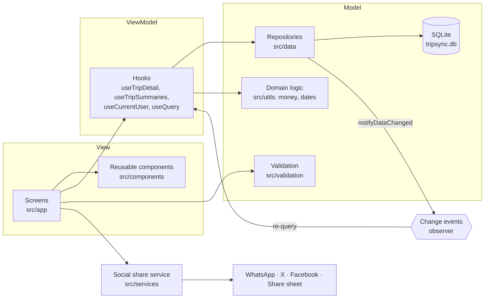
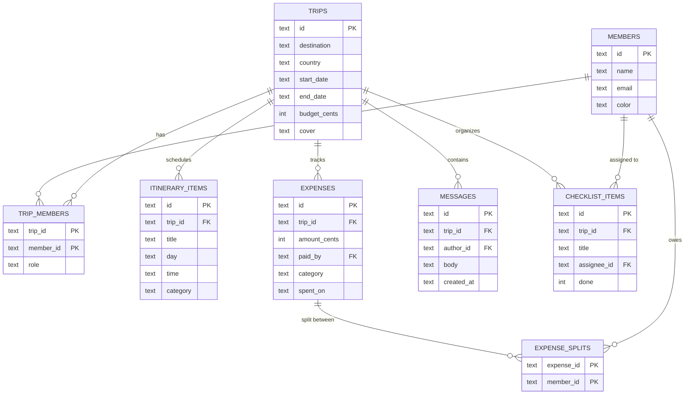

# TripSync — Architecture & Data Model

## Architectural pattern: MVVM + Repository

- **View (screens + components):** render data and capture input only. No SQL, no business rules.
- **ViewModel (hooks):** each screen asks for exactly the data it needs (`useTripDetail(id)`), already shaped for display.
- **Model (repositories, validation, utils):** repositories are the only code that touches the database; validators and pure utilities hold the business rules and are easy to test.
- **Observer pattern:** after every write, repositories call `notifyDataChanged()`; `useQuery` subscribes and re-reads, so every open screen updates instantly with no global state library.

### Other patterns used

| Pattern | Where | Why |
| --- | --- | --- |
| File-based routing | `src/app` (Expo Router) | Each screen is a file; deep links like `/trip/[id]` for free |
| Composition / reusable components | `src/components` | 30 typed components shared across screens (FormScreen, TextField, Card, ShareButtons…) |
| Strategy / adapter | `services/social-share.ts` | One `shareTo(target, message)` API; each platform has its own URL scheme and web fallback |
| Error boundary | `app/_layout.tsx` | Unexpected errors show a recovery screen instead of crashing |
| Design tokens | `constants/theme.ts` | Single source of truth for colors, spacing, type, shadows |
| Migrations | `db/schema.ts` | Versioned, transactional schema upgrades |

## Data model

## Key design decisions

| Decision | Alternatives considered | Reason |
| --- | --- | --- |
| On-device SQLite | Firebase / cloud backend | Works offline at the conference and while traveling; no accounts or keys to secure; relational integrity with constraints |
| Money in integer cents | Floating-point dollars | `0.1 + 0.2 ≠ 0.3` in floating point; cents are exact |
| Even split with remainder cents | Rounding each share | Shares always add back up to the exact total |
| Greedy settle-up (largest debtor ↔ largest creditor) | Pay each payer directly | Fewer payments for the group |
| Bundled photos | Loading from the internet | Instant and offline; licensing documented |
| Expo Router + typed routes | React Navigation config | Less boilerplate; compile-time route checking |
| TypeScript strict mode | JavaScript | Catches bugs before the app runs |

## Quality checks

- `npx tsc --noEmit`: strict TypeScript, zero errors.
- `npx expo lint`: ESLint with React and React Hooks rules, zero errors.
- Manual test plan: see [planning.md](planning.md#8-test-plan-manual-run-on-ios-android-and-web).

## Future roadmap

- Cloud sync and accounts (e.g. Firebase) so each traveler uses TripSync on their own phone, with the repository layer as the swap-in point.
- Polls for voting on activities, map view of the itinerary, receipt photos, and currency conversion.
