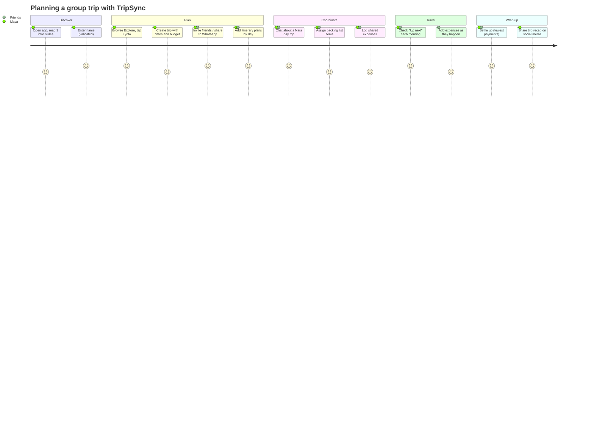

# TripSync — User Journey & UX Rationale

## User journey map (organizer persona: “Maya”)

| Stage | User goal | Screen(s) | Key design decision |
| --- | --- | --- | --- |
| First launch | Understand what the app does | Onboarding | 3 short slides, skippable, then one question (name); sample trip optional |
| Start a trip | Get from idea to trip quickly | Home → Create Trip / Explore | Big brand-colored Create Trip button; Explore pre-fills the form |
| Gather the group | Get friends involved | Trip → Overview → Invite / Share | Share cards open WhatsApp, X or Facebook with text pre-filled |
| Build the plan | Agree on a schedule | Trip → Plan | Grouped by day, sorted by time; clash detection prevents double-booking |
| Manage money | Track and split costs | Trip → Budget | Totals first, then settle-up, then details (progressive disclosure) |
| Stay organized | Don’t forget anything | Trip → Lists, Chat | Tap circle to complete, tap avatar to assign |
| During the trip | Know what’s next | Trip → Overview | “Up next” card and “Day 2 of 9” status |
| After the trip | Close out and remember | Home → Past Trips, Overview | Trip complete banner, recap share |

## UX design rationale

1. **One hub per trip.** Everything about a trip lives behind one card, with five clearly labeled tabs that map directly to the group’s needs (plan, money, talk, lists). Users never wonder where something is.
2. **Familiar iOS patterns.** Bottom tab bar, large titles, modal sheets for forms, grouped settings rows. Judges and users already know how these behave, so the app feels intuitive with no training.
3. **Progressive disclosure.** Home shows only what matters (where, when, who, budget progress). Details appear one tap deeper.
4. **Forgiving forms.** Hints show the expected format before typing; errors appear next to the field in plain language and say how to fix the problem. Errors clear as soon as the user edits.
5. **Consistency.** All colors, spacing, radii and type come from one token file (`src/constants/theme.ts`), and the app icon’s pin-and-sync mark reappears in the header, onboarding, help and splash screen.
6. **Offline-first.** Trips are stored on the device, and photos are bundled, so the app is fast and dependable while traveling.

## Accessibility features

| Feature | Implementation |
| --- | --- |
| Screen readers | `accessibilityRole`, `accessibilityLabel` and `accessibilityHint` on all interactive elements; cards read a full sentence summary |
| Error announcements | Inline errors use `accessibilityLiveRegion="polite"` / `role="alert"` |
| Touch targets | Buttons ≥ 44×44 pt, plus `hitSlop` on small icons |
| Contrast | Body and secondary text meet WCAG AA (≥ 4.5:1) |
| Not color-only | Status uses icons + text (e.g. “Completed” badge, strikethrough on done items) |
| Dynamic type | System font scaling respected throughout |
| Plain language | Short sentences, no jargon; Help screen explains every feature |
